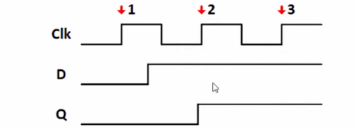
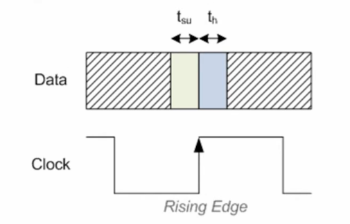
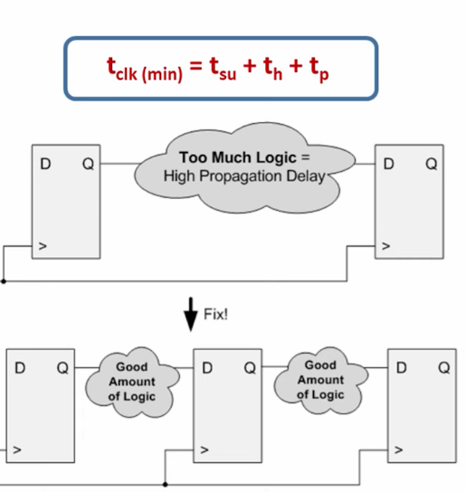
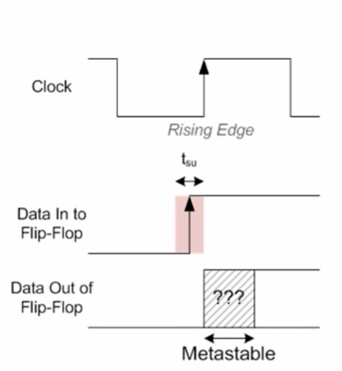

A flip flop outputs any data that appears on the Clk input (rising edge). So if D is high when Clk is high, the output goes high, but only if the Clk positive edge occurs while D is high. So D must be high prior to the Clk rising edge going up.

**Issue:** What happens when the D positive edge is really close to the rising edge of Clk? The flip flop needs to see input D (voltage). If D is in the process of going high or low during the Clk edge up, this leads to timing errors in your design.

### Setup and hold time

**Setup time:** Time required for stable data before the clock edge. Data needs to be unchanging for the **setup time**.

**Hold time:** Time required for stable data after the clock edge. Data needs to be unchanging during the hold time as well.

If data changes within the setup or hold time, this can lead to timing errors.

Setup/hold time is related to one flip flop.

When there are two flip flops (source and destination), we have propagation delay: the time it takes for the voltage signal to get through long wires between the two flip flops. Having gates/logic between the flip flops (TX and RX flip flops) also adds to propagation delay. Propagation delay is the time it takes for a signal to travel from a source to a destination. Passing voltage through wires takes time (on the level of nanoseconds). The longer the propagation delay is, the slower your clk is able to run. The closer the flip flops are, the shorter the propagation delay (similarly, the less logic between TX and RX, the shorter the propagation delay). So, all of this said, propagation delay stops us from running our clk as fast as we want, leading to time delays.

**Timing errors:** You tell the tool (place & route) your clock frequency (e.g. 200 MHz, 50 MHz, etc.). If you have any setup/hold times violated, you get a timing error. Good designs have zero timing errors.

**High-level how to fix timing errors:** tclk = tsu + th + tp (setup time + hold time + propagation delay). Setup and hold time are dictated by the FPGA (built in for each FF by the FPGA; you have no control over these parameters). You do have control over propagation delay, though: specifically, if you have too much logic between two flip flops, this will increase the delay. Logic is made by gates, run by look-up tables, etc. Long if/else chains of conditionals are a likely spot where high propagation delay is created. The solution for this is slowing down the main clock frequency (if it's not fixed; it's highly unlikely you can even change it), or you can break up your logic into stages (pipelining).

Pipelining to me seems like OOP or something, where we split up too much logic, brute force logic even, into good amounts of split-up logic. Pipelining does inherently create a 1 clock cycle delay per extra flip flop you add, but that doesn't mean you can't process less data. Pipelining is extremely common because you cannot do everything in one clock cycle; it is required for good programs.

**Metastability:** Very bad. It is a state of unbounded time during which it is unknown which state will eventually be adopted by the system. The flip flop is undefined and might oscillate 0 to 1, 1 to 0, etc. This is caused by setup/hold time violations, meaning the data and clk change within a very close span. In real-world applications, metastability is rare, however. A simple solution is to put two flip flops back to back, so that if the first flip flop goes metastable, it gets almost a full clock cycle to settle back to a clean 0 or 1 before the second flip flop samples it. This makes the chance of passing a bad value on to the next FF very small. It doesn't fully solve metastability, but it makes failures much rarer. Even without metastability, setup/hold violations are a problem because the FF may not capture the correct state at the right time. A last note is that metastability is a common problem when crossing clock domain boundaries. Clock domain boundaries happen when a signal generated by logic on one clock is sampled by logic running on a different, unrelated clock, so the receiving side can catch the incoming signal in the middle of switching between 0 and 1 → leads to metastability.

