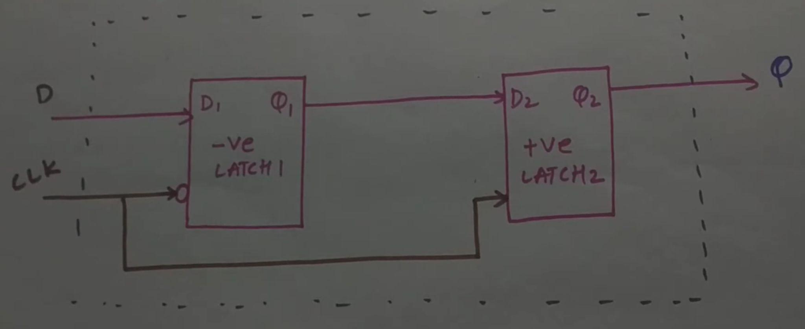
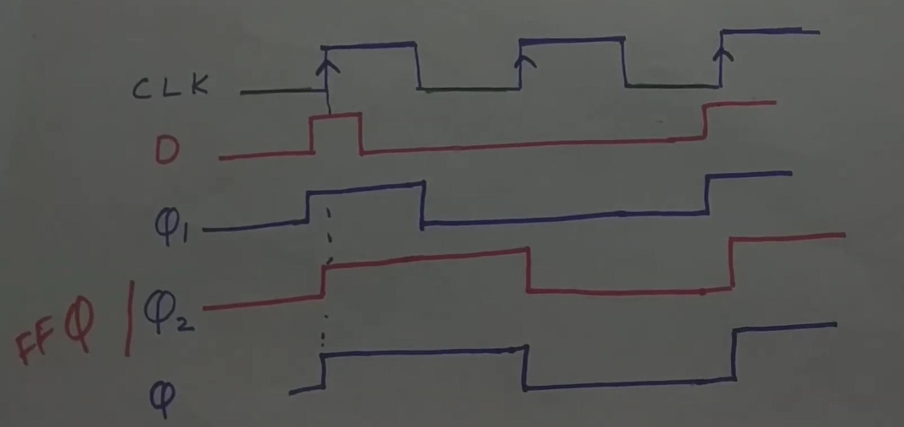
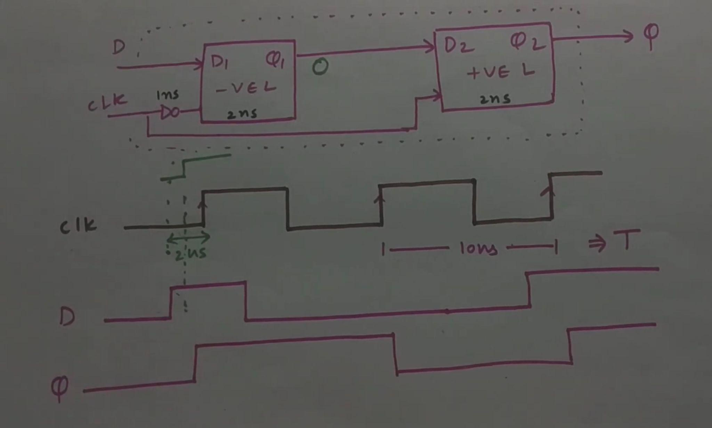

Below is a diagram for a combination of latches to create a flip flop.

It is created from a positive and a negative latch, the positive latch getting the output of the negative latch as its input, while the negative latch has an inverted clock, but the positive does not. This whole system acts as a D flip flop.

The timing diagram is as seen below. The negative latch output, Q1, holds its value when the clk is high, no matter what the D (input) is. The positive latch output, Q2, is high when the clock is high when the clock and Q1 are high. The flip flop output (Q2) is high during a clk high and Q1 high, and stays high until the next clock rising edge.

The setup time and hold time occur before and after a positive edge, respectively. In those regions prior to and after the clock edge, the value should not change between Low → High or High → Low.

Propagation delay was not considered in the prior diagram. Considering propagation delay, for example 2 ns per latch (both negative and positive), this means that if the input D goes high, Q1 latches and comes out 2 ns later, and Q2 the same. If the D signal is going high within the 2 ns propagation delay, then Q1 sees 0, not 1. This is because the input changing is happening too close to the clk signal, within the propagation delay. The value considered in the latch is the value prior to the 2 ns propagation delay, which in this case is 0. Keep in mind that the input should not be changed within the propagation delay prior to the clk edge going positive (setup time), as this would result in an inaccurate output. The propagation delay of the latch is the cause of the setup time, and the propagation delay from the inverter is the cause of the hold time (through the second latch).

The takeaway is that the input should not be changed within the setup time and hold time.
