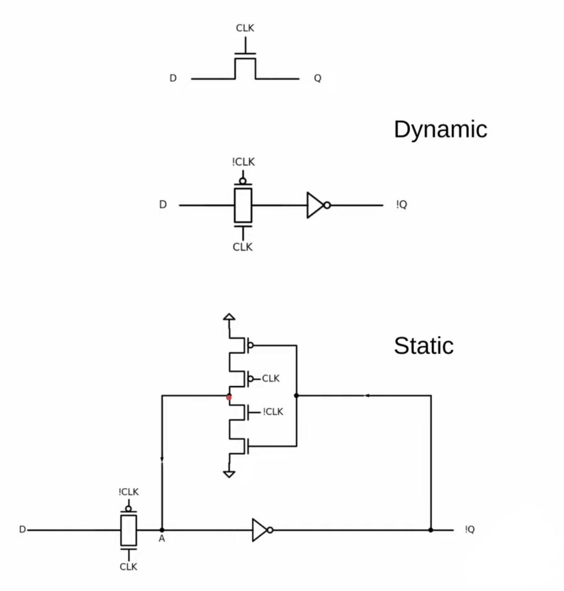
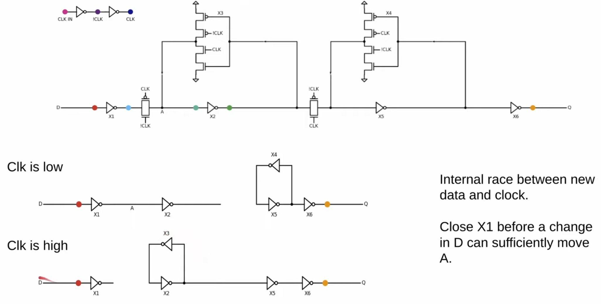
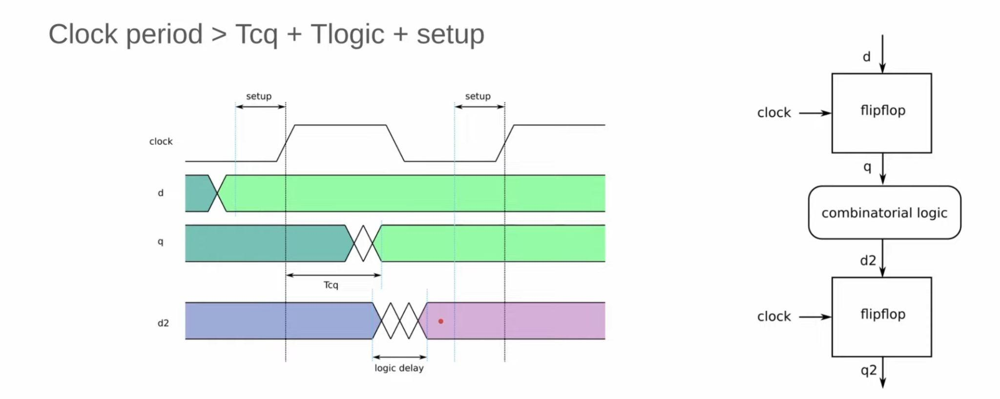
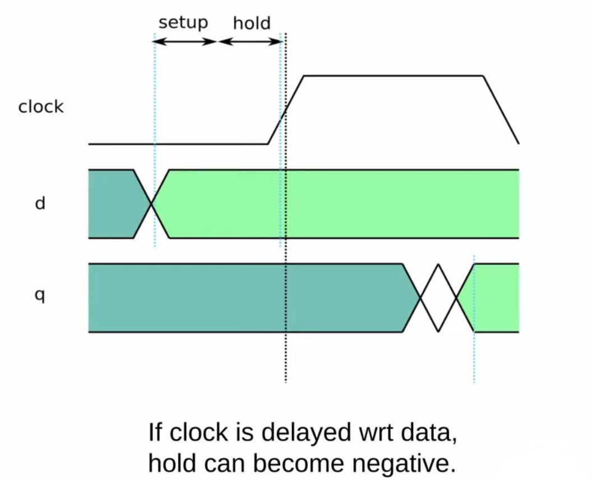

Had the time, so figured I'd learn some more about these concepts.

When designing digital logic for an FPGA or an ASIC, the part of the circuit doing the bulk of the work, like an adder, is all built from XOR, AND, etc. gates. When implementing a filter, where we want to take the output and route it back into the input, we will get a race condition where we lose control of what's happening. So we need to catch the data that is outputted, and then re-input it after some time, coordinated with a clock. This is done using latches and flip flops; they are for sequencing and data flow.

The simplest latch is purely a MOSFET with a D input and Q flowing out, which flows out the signal if the Clk is high (N-channel MOSFET). However, it's not immune to a noisy input. The output is only there because of capacitance on the wires, so as time goes on, Q degrades to a zero. We can improve it using a transmission gate with a P type and an N type in parallel. We can also put a buffer at the end to drive the output a bit higher, have a bit more capacitance, and make the output last a bit longer.

**Static case:** We can build up to a latch with a feedback circuit, where the input of one feeds a tri-state inverter, and comes back around and reinforces the circuit. This means we can disconnect the input with the transmission gate.

An ideal flip flop should have zero sequential overhead, meaning it should sample new data in zero time and output the updated value immediately. There should be no metastability, so no ambiguity on the output (always either 0 or 1), and samples should always sit exactly on the clk edge, or a bit forward/backward, but at a predictable time.

### How does a flip-flop flop?

Regarding the photo above: when the clock is low, the output is steady and isolated. The input is sampling all the time; D is inverted, then charges up A. When the clock goes high, the A transmission gate opens, so whatever is on A is now reinforced in the inverter loop in the Clk high diagram, and then the output goes straight into Q.

If the data is changing at the sample moment, we can get an oscillating 0 or 1 on the Clk high inverter loop.

Setup is the time that the signal needs to be steady in front of the clock signal, and hold is the time that the signal needs to be steady after the clock signal. The hold time CAN be negative, meaning the whole aperture is shifted in front of the clock.

How early D can change after the positive clock edge, and how late D can change before a new clock edge, are described below.

Tcq is the time for the data to come out of the flip flop, the logic delay is the time for the logic, and the setup time for the next clock edge is also seen. The slack is the time between the logic delay and the next setup time, and is the room you have to do other things before the next setup time occurs.

If there were any issues with the data changing in the setup time, we could fix this by increasing the clock period (decreasing the frequency), and this would bring the changing data out of the setup time, so it would get rid of any metastability.

The Tcq must always be bigger than the hold time. The Tcq and hold time are parameters of a flip flop and cannot be changed later; they do not rely on the clock period.

Now, if there are two different clocks, one for each flip flop, then data can change within the setup or the hold time very easily.
